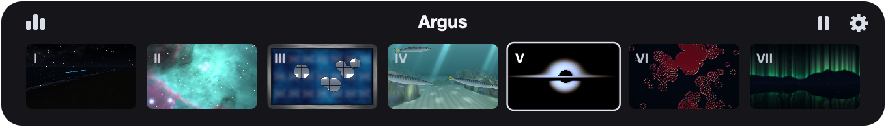
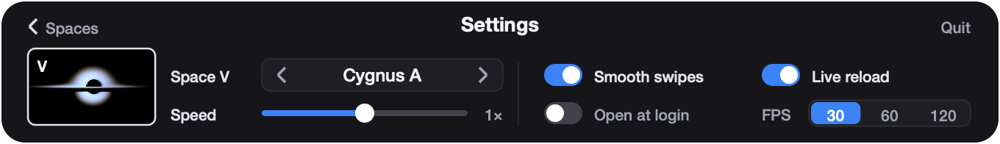

# Argus

**Live wallpapers for macOS that you write yourself: one Zig or Metal file per Desktop Space, running on the bare metal.**

Our programs live in terminals and editors. We rarely get to see them run in their full glory,
right there on the desktop. Argus fixes that: ignite a relativistic quasar behind your windows
for a few milliseconds of GPU a frame, or really anything you can write a pixel for.

<p align="center">
  
</p>
<p align="center"><a href="docs/media/hero.mp4">Watch in full quality (MP4)</a></p>

## What it is

Argus is a bare-metal macOS app that gives every Desktop Space its own live theme. Swipe from
one Space to the next and you swipe from a quasar to a night beach to a marbling bath.

A theme is a single source file in `themes/`:

- a **Metal kernel** (`.metal`) that answers "what colour is this pixel?" and runs on the GPU
  for every pixel at once, or
- a **Zig file** (`.zig`) that runs on the CPU through a tiny SDK, for simulations that are
  sequential and branchy.

Drop a file on a Space in the menu bar and Argus compiles it on the spot. Save an edit and it
reloads within a second. There is no engine to learn, no asset pipeline, no framework: you get
a pixel grid, a clock and a frame budget.

The engine itself is Zig 0.17.0 talking straight to the macOS frameworks, with no AppKit wrapper.
It runs at 30 FPS, draws only the Spaces you can see, and does nothing at all while a
full-screen app, the lock screen or a sleeping display covers them.

## The quasar

One quasar ships with the app, and it is real:

> **Cygnus A**  
> Quasar: spinning (Kerr) black hole with its accretion disk, both computed.

Kerr is what the black hole *is*: the exact solution for a
spinning black hole, which every real one should be. The quasar is what it is *doing*: feeding
through a luminous disk. Every pixel's light is traced along exact Kerr light paths, the disk's
glow comes from a physical model of a feeding quasar, and the approximations and artistic
choices are named as such.

The flagship is [`themes/Cygnus_A.zig`](themes/Cygnus_A.zig): the quasar hidden in Cygnus A,
2.5 billion Suns, feeding at about 1% of its limit, seen nearly edge-on. Why we think it is
real, and how you can check:

- **The light paths are tested against the exact answer.** The traced edge of the shadow is
  compared with Bardeen's analytic curve at 766 points. The worst error is 8.9e-6 M on the CPU
  and 1.8e-5 M on the GPU, under 1/2000 of a pixel.
- **Every checked claim is a record in a test ledger** (`make ledger`): the claim, its reference,
  the measured value, the bounds and the command that produced it. Cygnus A has 49 asserted
  claims, and all pass: [`docs/cygnus_a_ledger.json`](docs/cygnus_a_ledger.json).
- **The headers say what is computed and what is chosen.** Cygnus A's spin has never been
  measured, so its a = 0.9 is labelled a choice.

What you are looking at, how faithful each part is, how it was checked and how to reproduce it:
**[docs/QUASARS.md](docs/QUASARS.md)**. The full model, derivations and open questions for
physicists: [docs/QUASAR_MODEL.md](docs/QUASAR_MODEL.md).

Want your own? Cygnus A is generated from a template (`make quasars`); give it a mass, a
spin and a feeding rate and grow your own plump one.

Beyond the black hole: [`Night_Tide`](themes/Night_Tide.metal), a beautiful night on the
coast where the flashes in the surf follow published dinoflagellate research, and
[`Lizard_Island`](themes/Lizard_Island.metal), a diver's drift over a real Great Barrier Reef
lagoon at metre scale, built from field sources. And more in
[`themes/`](themes/): drag any of them onto a Space.

## Install

Download the release zip and open Argus.app. No Zig needed: every theme ships precompiled.
The first time, macOS asks you to approve an app that isn't notarized;
[docs/INSTALL.md](docs/INSTALL.md) has the steps. The download also carries the theme-writing
guides: open `WRITING_THEMES.md` in the unzipped folder, or open Claude Code there and ask for a
theme (it finds the skills in `.claude/skills/` on its own).

**Themes are native code.** A Zig theme becomes a dynamic library inside Argus, and a Metal
theme runs on your GPU. Only run themes you trust. See [SECURITY.md](SECURITY.md).

## Build and run

Requires macOS on Apple Silicon and Zig 0.17.0 (`make zig` installs it into `.toolchain/`,
checksum-verified; `brew install zig` also works).

```sh
git clone https://github.com/gke0op/argus.git
cd argus
make zig                                  # install the pinned Zig 0.17.0 into .toolchain/
make run                                  # build Argus.app and start it
make stop                                 # quit it
make test                                 # run the test suites
make harness THEME=themes/Cygnus_A.zig    # verify and benchmark a theme headlessly
make harness THEME=themes/Tutorial_Tides.metal   # same, on the GPU for Metal themes
make check-themes                         # the harness on every theme
make release                              # dist/Argus-v<version>-macos-arm64.zip for a GitHub Release
```

Then click the eye in the menu bar. The Spaces strip shows one thumbnail per Desktop Space:
drop a theme (or a picture) on any of them, and double-click one (or tap it with two fingers)
to eject its theme and give that Space back to macOS. Pause with ⏸ (the eye closes while paused). The
gear opens Settings: step a Space's theme (or go back to the macOS default), speed, frame rate
(30 by default; 60, or 120 on ProMotion displays: smoother, but the cost grows with the rate),
smooth swipes, live reload and open at login. Settings live in `.argus_settings.conf` next to
Argus.app, one `key=value` per line.

<p align="center">
  
</p>
<p align="center">
  
</p>

## Write your own theme

The quickest way in is a Metal kernel:

```cpp
kernel void argus_draw(constant ArgusFrame& f [[buffer(0)]],
                       texture2d<float, access::write> out [[texture(0)]],
                       uint2 gid [[thread_position_in_grid]]) {
    if (gid.x >= f.width || gid.y >= f.height) return;
    const float2 uv = argus_uv(gid, f);
    float3 col = 0.5f + 0.5f * cos(f.time + uv.xyx + float3(0, 2, 4));
    out.write(float4(saturate(col), 1.0f), gid);
}
```

1. Read the two tutorials, in order:
   - [`themes/Tutorial_Tides.metal`](themes/Tutorial_Tides.metal): an aurora over a night sea in
     five small steps. No state, just "what colour is this pixel at this time?".
   - [`themes/Tutorial_Reef.metal`](themes/Tutorial_Reef.metal): a reaction-diffusion reef that
     remembers, with a state texture that persists between frames.
2. Copy one to `themes/<You>_<Name>.metal` and run the harness:
   ```sh
   make harness THEME=themes/You_Name.metal
   ```
   It compiles the theme, runs it at 1920x1200 and at 320x200, checks for NaN/Inf and motion,
   times it, and writes a PNG.
3. Drop the file on a Space and keep editing; Argus reloads it when you save.

The full Metal contract (prelude helpers, state textures, data files, measured performance
rules for Apple GPUs) is in [`.claude/skills/argus-metal-theme/SKILL.md`](.claude/skills/argus-metal-theme/SKILL.md).
It is written so a coding agent can follow it, and it reads fine for people too. The guide
keeps improving: every theme author, human or agent, leaves notes in
[`.claude/skills/FIELD_NOTES.md`](.claude/skills/FIELD_NOTES.md), and the lessons go back into
the skills.

**CPU themes in Zig** use [`themes/argus_theme_sdk.zig`](themes/argus_theme_sdk.zig): a
`State` struct with `init`, `step`, `draw` and `deinit`, one allocation at init and none
after. This release ships no small Zig starter: the SDK's header shows the whole contract,
[`themes/Cygnus_A.zig`](themes/Cygnus_A.zig) is a complete (and large) example, and the former
reference theme is in the history (`git show f566e3a:themes/Echo.zig`). The contract and
the harness gates are spelled out in [BENCHMARK.md](BENCHMARK.md).

### What it costs

Measured on an M3 with 8 GB: one Space showing the theme at Argus's 30 FPS.

| Theme | GPU per frame (paced 30 FPS) | GPU busy | CPU | Memory |
| :--- | ---: | ---: | ---: | ---: |
| `Tutorial_Tides.metal` | 1.3 ms | ~7% | ~2% | 83 MB |
| `Ebru_Studio.metal` | 1.7 ms | ~11% | ~2% | 114 MB |
| `Tutorial_Reef.metal` | 1.7–2.1 ms | ~15% | ~2% | ~95 MB |
| `Orion_Nebula.metal` | 2.0–2.8 ms | ~14% | ~2% | 93 MB |
| `Night_Tide.metal` | 2.7–2.9 ms | ~25% | ~2% | ~94 MB |
| `Lizard_Island.metal` | 3.9–4.2 ms | ~32% | ~2% | ~190 MB |
| `Cygnus_A` (GPU, HDR10, native resolution) | 2.6–2.8 ms | ~12% | ~13% | ~290 MB |

Argus with no theme: 13 MB, 0.2% CPU, no GPU. Hidden Spaces don't draw; each extra Space showing a
theme adds memory (see BENCHMARK.md), and Spaces showing the same black hole share its traced image.

The full table, with back-to-back figures and memory on four Spaces, is in [BENCHMARK.md](BENCHMARK.md).

## ARGUS-BENCH: a benchmark for coding models

Instead of benchmarks you'll never use: hand your agent one sentence and see how much
creativity and metal affinity it has.

[BENCHMARK.md](BENCHMARK.md) is a self-contained prompt you can give any coding model: write
one Zig 0.17.0 file that simulates something real and passes eight automated gates (compiles,
one allocation, survives a 320x200 watchdog, respects the row stride, opaque pixels, no NaN,
visible motion, under 16.7 ms a frame on one CPU core). A submission that passes is, at the
same moment, a wallpaper you can drop on a Space.

Several earlier themes, now in the git history, started as answers to it, and the table in
BENCHMARK.md records who wrote each one.

## How it was made

Argus started as a 24-hour build. Most of the code was written by AI systems directed by
Ekmel Ozdemir: Argon (Google Gemini) wrote the first engine, the SDK, the harness and the
benchmark; Claude Opus wrote most of the later engine work and the physics themes; 10+ agents
from various model families contributed themes and species. The git history is the full
record, and [NOTICE.md](NOTICE.md) credits each piece.

## Contributing

Themes are the best way in. [CONTRIBUTING.md](CONTRIBUTING.md) covers the contract, the
harness gates, the frame budget, honest headers and credit lines. If you think a physics claim
is wrong, open a "physics claim challenge" issue with a source; that is the most useful report
this project can get.

## Licence

MIT, see [LICENSE](LICENSE). Data files carry their own licences (the Orion Nebula data is
CC0 and CC BY 4.0); see [NOTICE.md](NOTICE.md).
